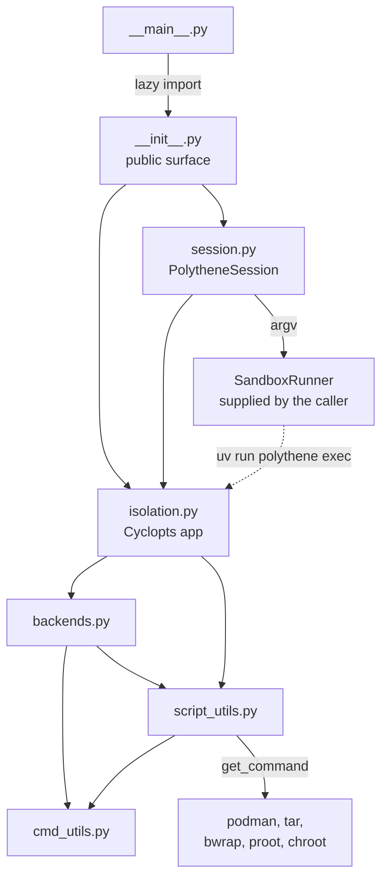

# Developer guide

This guide records the architecture, package layout, testing strategy, local
development workflow, and quality contracts for Polythene. For the command-line
interface and user-facing behaviour, see the [users' guide](./users-guide.md);
for the trade-offs behind the current design, see the
[design document](./polythene-design.md).

## Architecture overview

Polythene is a small package arranged in three cooperating layers:

- `isolation.py` owns the Cyclopts application, the `pull` and `exec` commands,
  the store layout, and the registry *binding* — it holds
  `BACKENDS = create_backends()`, while `backends.py` constructs the tuple.
- `backends.py` describes the execution backends — bubblewrap, proot, and
  chroot — as data, together with the probes that decide whether each one can
  run.
- `cmd_utils.py` and `script_utils.py` hold the process and filesystem helpers
  the other two layers share: `run_cmd` executes and echoes a plumbum command,
  `get_command` resolves a binary or exits `127`, and `ensure_directory`
  creates the store and runtime directories.

`isolation.py` computes its configuration when the module is imported, not when
a command runs:

- `DEFAULT_STORE` is `POLYTHENE_STORE` when that variable is set, and
  `tempfile.gettempdir()/polythene` otherwise, resolved to an absolute path.
- `VERBOSE` is true when `POLYTHENE_VERBOSE` is set to any non-empty value.
  The test is `bool(os.environ.get(...))`, so an empty string leaves verbose
  mode off.
- `IS_ROOT` records whether the effective user is root (`os.geteuid() == 0`).
- `BACKENDS` is the registry returned by `create_backends()`, in the fixed
  order bubblewrap, proot, chroot.
- `CONTAINERS_STORAGE_DRIVER=vfs` and `CONTAINERS_EVENTS_BACKEND=file` are set
  with `os.environ.setdefault`, so an inherited value wins.

Because those constants are bound at import time, tests patch them by attribute
(`monkeypatch.setattr(isolation, "BACKENDS", ...)`).

The environment is a second, later input. `app.config` installs
`cyclopts.config.Env("POLYTHENE_", command=False)`, which binds each
parameter's name to `POLYTHENE_<NAME>` with the name upper-cased and `-` and
`.` rendered as `_`. Binding is by parameter, not by *option*: a positional
parameter is matched too, so `POLYTHENE_UUID` supplies the `uuid` that `exec`
would otherwise take from the command line — the command then errors on its own
terms (no rootfs for that UUID) rather than for a missing argument.
`POLYTHENE_TIMEOUT` reaches `--timeout`, and `POLYTHENE_STORE` reaches
`--store`, without the option's own `env_var` being involved. A value that
cannot be coerced is reported as
`Invalid value for "POLYTHENE_TIMEOUT" from env`, not as a bad command line.
`--store` and `--isolation` also declare `env_var` explicitly, which makes the
binding legible at the option rather than only in the app's configuration.

Both routes are read afresh on each invocation, so a variable set after import
still reaches the command even though `DEFAULT_STORE` was fixed at import. The
two agree for `POLYTHENE_STORE`; the `default` of `--store` is the
already-resolved `DEFAULT_STORE`, so an unset variable leaves the import-time
value in place.

A command token that *looks like one of the command's own options* survives
only because a bare `--` separates it from the outer parser: after the
delimiter, Cyclopts stops parsing options and passes the remainder through as
tokens, so `exec UUID -- --timeout notanint echo x` reaches the rootfs while
`exec UUID --timeout notanint echo x` fails on the coercion of `notanint`. That
is the form `PolytheneSession` emits. The `--` is load bearing; the
`app.end_of_options_delimiter = "--"` assignment beside the app is not, because
`--` is already Cyclopts's default and `App._resolve` falls back to it when
nothing is set. The assignment records the default rather than enabling it;
deleting it would not change behaviour. `CommandToken`'s `allow_leading_hyphen`
covers the rest, admitting a hyphen-led token such as `-n` in either form.

Three terms recur throughout this guide, and are kept distinct:

- **Backend availability fallback** — `exec` probing backends in order and
  moving to the next when one declines. It decides which tool runs a command,
  not what that command does.
- **Process execution** — running the inner command through the selected
  backend, and turning the resulting status into the CLI's exit code.
- **Persistent rootfs storage** — the store directory of UUID-named root
  filesystem trees that outlives any single invocation, so a `pull` in one job
  can be reused by a later `exec`.

For screen readers: the diagram shows how the package modules depend on one
another, how the helper layer resolves the external tools, and how
`PolytheneSession` reaches the CLI through a caller-supplied runner.



## Package layout

The `polythene/` package holds seven modules:

| Module            | Role                                                  | Key APIs                                                                                                                                                                                         |
| ----------------- | ----------------------------------------------------- | ------------------------------------------------------------------------------------------------------------------------------------------------------------------------------------------------ |
| `__init__.py`     | Public package surface                                | `DEFAULT_STORE`, `CONTAINER_TMP`, `BACKENDS`, `IS_ROOT`, `VERBOSE`, `app`, `cmd_pull`, `cmd_exec`, `export_rootfs`, `generate_uuid`, `log`, `main`, `store_path_for`, `PolytheneSession`         |
| `__main__.py`     | Module entry point                                    | `main`                                                                                                                                                                                           |
| `isolation.py`    | CLI, configuration, store layout, image export        | `app`, `cmd_pull`, `cmd_exec`, `export_rootfs`, `generate_uuid`, `store_path_for`, `log`, `DEFAULT_STORE`, `CONTAINER_TMP`, `VERBOSE`, `IS_ROOT`, `BACKENDS`, `IsolationName`, `ISOLATION_NAMES` |
| `backends.py`     | Backend descriptors and availability probes           | `Backend`, `BackendContext`, `BubblewrapUnavailable`, `create_backends`, `ensure_runtime_paths`, `make_prepare_bwrap`, `make_prepare_proot`, `make_prepare_chroot`                               |
| `cmd_utils.py`    | Process execution and echoing                         | `run_cmd`, `TimeoutConflictError`                                                                                                                                                                |
| `script_utils.py` | Command resolution and filesystem helpers             | `get_command`, `ensure_exists`, `ensure_directory`, `unique_match`, `PKG_DIR`                                                                                                                    |
| `session.py`      | Argument-vector construction for programmatic callers | `PolytheneSession`, `SandboxRunner`                                                                                                                                                              |

The `polythene/unittests/` directory is a legacy placeholder holding only a
`README.md`; the suite lives in `tests/`, described under
[Testing strategy](#testing-strategy).

`__main__.py` imports lazily: its `main` performs
`from . import main as package_main` inside the function body, so
`python -m polythene` reaches the package's `main` without importing the CLI at
module scope. Both subcommands are defined in `isolation.py` with the Cyclopts
decorators (`@app.command(name="pull")` and `@app.command(name="exec")`), and
the package-level `main(argv)` passes `sys.argv[1:]` to the app. The
`polythene` console script declared in `pyproject.toml` points at
`polythene.__main__:main`, so the installed entry point and
`python -m polythene` converge on the same function.

Exit codes are few and deliberate:

| Code  | Raised by                       | Condition                                             |
| ----- | ------------------------------- | ----------------------------------------------------- |
| `1`   | `cmd_exec`                      | The UUID has no directory in the store                |
| `1`   | Cyclopts option validation      | `--isolation` names an unknown backend                |
| `2`   | `cmd_exec`                      | No command tokens were supplied                       |
| `2`   | `ensure_exists`, `unique_match` | A required path is missing, or a match is not unique  |
| `126` | `cmd_exec`                      | Every isolation backend declined                      |
| `127` | `get_command`                   | A required binary, such as `podman`, is not on `PATH` |

Other statuses are propagated rather than translated in the places that handle
them: a backend's non-zero status from `cmd_exec`, and an unexpected probe
status, each become the CLI's exit code, as do the statuses of `podman pull` and
`podman create`, which are caught as `ProcessExecutionError` and passed through
`_normalize_retcode`.

The export pipeline is the exception. `podman export CID | tar -C DEST -x` runs
inside a `try/finally` that only removes the container; there is no
`except ProcessExecutionError`, so a failed export leaks plumbum's exception
instead of translating it, and the interpreter's traceback exit status is what
the caller observes rather than the failing command's status.

`PolytheneSession` builds an argument vector and hands it to its runner. It
does not execute anything itself, does not create or clean the store, and does
not check that the UUID exists — all of that stays with the CLI.

## Runtime flows

### `polythene pull`

1. `cmd_pull` ensures the store directory exists.
2. It generates a UUIDv7 with `uuid7()` and takes `store/UUID` as the
   destination.
3. `export_rootfs` resolves `podman` and `tar` through `get_command`, which
   exits `127` when either is missing.
4. It probes local storage with `podman image exists IMAGE`, run with
   `retcode=None` so the status is read rather than raised: `0` means the image
   is present, `1` means it is absent, and anything else — `125` for unreadable
   storage included — prints `Failed to check for local image IMAGE` and exits
   with that status.
5. When the probe reports the image absent, it pulls with `podman pull IMAGE`
   in the foreground; a `ProcessExecutionError` prints
   `Failed to pull image IMAGE` and exits with the failing command's status.
6. It creates the destination directory with `exist_ok=False`.
7. It creates a stopped container with `podman create --pull=never IMAGE true`,
   reads the container ID from that command's stdout, streams
   `podman export CID | tar -C DEST -x`, and removes the container with
   `podman rm CID` in a `finally` block whose failure is suppressed.
8. It writes `DEST/.polythene-meta` best-effort, `cmd_pull` calls
   `ensure_runtime_paths` to create `dev/` and `tmp/`, and the UUID is printed
   to stdout.

Printing the UUID alone is a contract, so steps 5 and 7 sink `podman pull` and
`podman rm` to `subprocess.DEVNULL`: those two report the image and container
ID on stdout and would otherwise contaminate it. The `podman create` in step 7
also writes a container ID to stdout, but there that output is the *intended*
result rather than noise — it is read back and stripped into `cid`, which is
why that call stays on the ordinary path.

The lifetimes are deliberately narrow. The container from step 7 is removed
after the export when cleanup succeeds, but cleanup is best-effort: a
`podman rm` that fails is suppressed, and the container can be left behind. The
image is pulled at most once per `pull`, and the persistent artefacts are the
exported directory and its metadata file. `--timeout` reaches every external
command in the flow, so it bounds each operation rather than the export as a
whole. A collision on the destination directory raises `FileExistsError`, which
`cmd_pull` answers by generating a fresh UUID once and retrying.

### `polythene exec`

1. `cmd_exec` requires at least one command token; otherwise it prints
   `No command provided` and exits `2`.
2. It resolves the rootfs path; when it is not a directory it prints
   `No such UUID rootfs: UUID (PATH)` and exits `1`.
3. It normalizes the tokens — a single sequence argument is flattened, and any
   non-string token raises `TypeError` — and quotes them with `shlex.quote`
   into one inner command string.
4. It walks the backend order, running each candidate. Python's `None` means
   the backend declined: the CLI logs the fallback and tries the next one. A
   `(name, status)` pair with status `0` returns, and any other status exits
   with that code. A `ProcessExecutionError` from the backend exits with the
   failing command's status.
5. If no backend ran, it prints
   `All isolation modes unavailable (bwrap/proot/chroot).` and exits `126`.

The order walked in step 4 is the registry order — bubblewrap, proot, chroot —
unless `--isolation` reorders it. The accepted names are `bubblewrap`, `proot`,
and `chroot`; anything else is rejected by the option's annotation — Cyclopts
prints `Invalid value for "--isolation"` and exits `1` — so the
`except KeyError` branch inside `cmd_exec` is unreachable from the CLI. A
requested backend is tried first and the remainder follow in registry order, so
the preference is a reordering rather than an exclusive selection. `chroot` is
the only backend that sets `requires_root`, and it is skipped when the
effective user is not root; bubblewrap and proot are never skipped for
privilege reasons.

### Backend probes and flags

Each backend resolves its binary before running any probe: a `SystemExit` from
`get_command` is logged and the backend declines with `None` without probing at
all. Probes otherwise run before the real command and decline by returning
`None` rather than raising, which is what drives the availability fallback.

- **bubblewrap** (`bwrap`). `_probe_bwrap_userns` short-circuits without
  running anything when the process is not root and
  `/proc/sys/kernel/unprivileged_userns_clone` reads exactly `0`; a missing
  file is not fatal, and an unreadable one is logged and ignored. It then runs
  `bwrap --unshare-user --uid 0 --gid 0 --bind / / true`. A *recognized*
  permission error — `Permission denied` in the output, or `errno.EPERM` —
  disables bubblewrap outright; an unrecognized failure logs and continues with
  an empty flag list. A successful probe contributes
  `--unshare-user --uid 0 --gid 0`, extended with
  `--unshare-pid --unshare-ipc --unshare-uts`. `_probe_bwrap_proc` binds the
  root and tries `--proc /proc`, keeping that flag only if it works. The full
  probe binds the root at `/`, dev-binds `/dev`, adds the proc binding when it
  survived, mounts a tmpfs over `CONTAINER_TMP`, changes to `/`, and runs
  `/bin/sh -c true`; execution reuses the same flags with the inner command in
  place of `true`.
- **proot** (`proot`). The probe runs `proot -R ROOT -0 /bin/sh -c true` and
  execution runs `proot -R ROOT -0 /bin/sh -c INNER`. The shell is deliberately
  not a login shell, so profile scripts cannot change the environment between
  the probe and the real command.
- **chroot** (`chroot`). It sets `requires_root` and clears `ensure_dirs`, so
  it neither runs as an unprivileged user nor recreates the runtime
  directories. The probe runs `chroot ROOT /bin/sh -c true`; execution runs
  `chroot ROOT /bin/sh -lc 'export PATH=/bin:/sbin:/usr/bin:/usr/sbin; INNER'`.
  This is the only login shell in the package, and the fixed `PATH` is there
  because chroot supplies no environment of its own.

These flags concern namespaces and mounts rather than isolation boundaries that
Polythene enforces. Bubblewrap unshares the user, PID, IPC, and UTS namespaces;
no backend is given a network-namespace flag, and this guide makes no claim
that any of the three blocks network access.

### Process execution

`run_cmd` is the single place that starts an external command. It echoes
`$ <command>` to stderr before running, requires the runtime-checkable
`SupportsFormulate` protocol — an object exposing `formulate()` and
`__call__()` — rejecting anything else with `TypeError`, and raises
`TimeoutConflictError` when a timeout arrives both as an argument and in
`**run_kwargs`.

A foreground call normally inherits the caller's streams. It leaves that path
in two cases: a timeout is set, or the caller passes an explicit `stdin`,
`stdout`, or `stderr` override. Both route through `_run_fg_with_overrides`,
which drives `cmd.run(timeout=...)` rather than `FG` — `FG` hard-codes
inherited streams and so cannot express an override. That helper then names all
three streams explicitly, defaulting the ones the caller left unset to `None`.
The `stdin` default is the load-bearing one: plumbum's `_popen` defaults an
unspecified `stdin` to a pipe and `run_proc` drains it with `communicate()`, so
omitting it would hand the child an immediate EOF instead of the caller's
terminal. Because a timed call already takes this path, a `--timeout` run and a
no-timeout run behave identically.

Stream overrides exist for callers that must keep a chatty tool off their own
streams. `polythene pull` passes `stdout=subprocess.DEVNULL` for `podman pull`
and `podman rm`, so the UUID stays the only line it prints. Everything else in
the package inherits the streams unchanged.

Timeout translation is confined to the foreground path. When `fg=True` and a
timeout is set, plumbum's `ProcessTimedOut` is re-raised as the builtin
`TimeoutError`. The non-foreground path forwards the timeout to `cmd.run`
without that `except` clause, so a non-foreground call that times out — the
`podman image exists` probe and `podman create` in `export_rootfs` are the two
in this package — raises `ProcessTimedOut` to its caller rather than
`TimeoutError`. `ProcessTimedOut` derives from `Exception`, not
`ProcessExecutionError`, so the surrounding `except ProcessExecutionError`
handlers do not catch it.

The `timeout` value travels with each operation rather than the invocation: in
`pull` it reaches the probe, the pull, `create`, the export, and `rm`, and in
`exec` it reaches every probe and the final execution. It is therefore a budget
per external command, not for the whole run.

### `PolytheneSession`

`PolytheneSession.run(uuid, command, *, isolation=None, timeout=None)` is the
programmatic entry point. It builds one argument vector:

```plaintext
uv run polythene exec UUID --store STORE [--isolation NAME] -- TOKEN...
```

The details that callers depend on:

- `command` may be a string, which is parsed with
  `shlex.split(comments=False, posix=True)`, or a sequence, which is used as
  given. Either way an empty result raises
  `ValueError("Command must contain at least one token")`.
- `--isolation` is emitted as two tokens, never as `--isolation=NAME`.
- The isolation preference order is the `isolation` argument, then
  `POLYTHENE_ISOLATION` from the session's environment, then `proot` when
  `GITHUB_ACTIONS` is truthy (`1`, `true`, `yes`, or `on`, case-insensitively).
  When none applies, no `--isolation` token is emitted and the CLI's own
  registry order decides. An unrecognized `POLYTHENE_ISOLATION` value raises
  `ValueError` naming the supported values.
- `timeout` is forwarded to `sandbox.run(argv, timeout=timeout)`. It is never
  added to the argument vector, so the CLI's `--timeout` is unaffected and the
  runner alone decides how to enforce the limit.
- `store` defaults to `DEFAULT_STORE`; a relative path is resolved against the
  working directory. `env` defaults to a copy of `os.environ` taken when the
  session is constructed.

## Testing strategy

Every test lives under `tests/`. `tests/`, `tests/bdd/`, and `tests/support/`
are real packages: their `__init__.py` files give each module one unambiguous
dotted path such as `tests.support.cli`, so a helper can be imported by name
from anywhere in the suite. There is no `tests/unit/` directory.

`tests/workflow_contracts/` is the exception. It has no `__init__.py`, so
pytest imports its single module by the bare filename — `test_cv005_wiring`, not
`tests.workflow_contracts.test_cv005_wiring` — and puts the directory on
`sys.path` to do it. Nothing in that module imports a sibling, so the two
conventions do not collide; a helper added there would need the package
treatment the rest of the suite uses.

| Location                                        | Contents                                                                                                                                                            |
| ----------------------------------------------- | ------------------------------------------------------------------------------------------------------------------------------------------------------------------- |
| `tests/test_*.py`                               | Unit tests for the package modules: the CLI, the backend probes, the image-export contract, the process helpers, the script-utility helpers, and the session helper |
| `tests/features/*.feature`                      | Gherkin scenarios describing CLI, command-execution, and script-utility behaviour                                                                                   |
| `tests/bdd/test_*_behaviour.py`                 | pytest-bdd step bindings that execute those scenarios                                                                                                               |
| `tests/conftest.py`                             | The `run_cli` and `run_module_cli` fixtures                                                                                                                         |
| `tests/support/`                                | Importable helpers: the `CliResult` type and the recording Podman doubles                                                                                           |
| `tests/test_workflow_contract.py`               | Contract tests for the mutation-testing caller workflow                                                                                                             |
| `tests/workflow_contracts/test_cv005_wiring.py` | Contract tests for the CV-005 checker's local wiring                                                                                                                |

Test bodies call real functions. Where a module shells out, the double replaces
the resolution point rather than the logic: `tests/support/podman.py` provides
typed recording stand-ins for `podman` and `tar`, and
`install_recording_tools(monkeypatch)` patches
`polythene.isolation.get_command` and `polythene.isolation.run_cmd` so
`export_rootfs` runs end to end with the real control flow and no container
runtime. The recorded `CommandRecord` objects carry the argv, the `fg` choice,
the timeout, and the other run options, so a test can assert ordering and exact
arguments. Other tests run genuinely lightweight commands — `echo`, and a
one-line Python snippet — through plumbum, which is what the `run_cmd` tests
are about.

Each Gherkin feature file lives in `tests/features/` and is bound by a module in
`tests/bdd/` through `scenarios("../features/NAME.feature")`; the bindings are
decorated with pytest-bdd's `given`, `when`, and `then`, with `parsers.parse`
supplying the step parameters. Adding a scenario therefore means adding a
`.feature` line and any steps it needs, not a new test function.

`tests/conftest.py` exports two fixtures. `run_cli` calls `polythene.app(args)`
with stdout and stderr redirected and turns the resulting `SystemExit` into an
exit code. `run_module_cli` runs `run_module("polythene", run_name="__main__")`
with `sys.argv` patched, so the module entry point is covered as well; it
restores the patch in a `finally` block. Both return a
`tests.support.cli.CliResult` holding `exit_code`, `stdout`, and `stderr`.
Those helpers live in `tests/support/` rather than in `conftest.py` so every
consumer imports the same module object; pytest collects `conftest.py`
specially, and `from conftest import ...` can otherwise create a second,
structurally identical copy of a type under some import-mode combinations — the
problem mutmut's sandbox exposed.

The suite uses no mocking framework: there is no `cmd-mox` and no
`pytest-mock`, and neither is a declared dependency. Doubles are handwritten
classes, a local stub, or `monkeypatch`. `pytest-timeout` is a development
dependency, and `[tool.pytest.ini_options]` sets `timeout = 30`, so every test
is killed after thirty seconds.

## Mutation and contract testing

Mutation testing does not run locally. There is no mutation Make target, and
`mutmut` is not a declared dependency; the configuration in `pyproject.toml`
(`source_paths = ["polythene/"]`,
`pytest_add_cli_args_test_selection = ["tests/"]`) exists for the workflow that
runs elsewhere.

`.github/workflows/mutation-testing.yml` is a thin caller: it schedules the
shared `leynos/shared-actions/.github/workflows/mutation-mutmut.yml` reusable
workflow daily at 05:50 UTC, offers a plain `workflow_dispatch`, and pins the
reusable workflow to a full commit SHA. The `with:` block passes only
`paths: "polythene/"` and `module-prefix-strip: ""`. Thresholds, reporting, and
tool versions belong to the shared workflow, not to this repository, and the
caller narrows its token to `contents: read` plus `id-token: write` for the
workflow-source resolution. `tests/test_workflow_contract.py` parses that
caller and asserts its shape: the workflow path, a 40-character commit SHA, the
least-privilege permissions, the empty top-level `permissions`, the
non-cancelling per-ref concurrency group, the schedule and dispatch triggers,
and the two `with` values. It deliberately does not assert the SHA value, which
Dependabot owns.

`tests/test_workflow_contract.py` carries a `pytest.mark.skipif` on the
workflow path, because mutmut's `mutants/` sandbox does not copy `.github/`;
the reason string in the skip marker says so. Without that guard the sandboxed
run would fail on a missing file rather than on a real defect. That guard is
local to this module, not a convention the suite follows:
`tests/workflow_contracts/test_cv005_wiring.py` has no `skipif`, so a missing
`Makefile` or `ci.yml` makes it fail rather than skip.

The CodeScene contract works the same way but runs locally.
`make test-workflow-contracts` runs `cv005-contracts check --repository .` from
the shared `cv005-contracts` library in `leynos/shared-actions`, pinned by
`CV005_CONTRACTS_REF`, and protects the separation between pull-request
ratcheting and main-branch CodeScene publication. The rules it enforces, and
the reasoning behind them, are in [Coverage ownership](#coverage-ownership).
What the library cannot prove is that this repository calls it, so
`tests/workflow_contracts/test_cv005_wiring.py` reads the Makefile with
`make -n` and parses the workflow to hold the pin to a full commit, the target
to `check --repository .` under Python 3.13, `.github/cv005.toml` to this
repository's name, `make all` to the target, and CI to an unconditional step
that runs it. The decision to take the library rather than keep a local copy is
recorded in [ADR 001](adr-001-adopt-the-shared-cv005-contract-library.md).

Both layers check configuration, not outcomes. The contracts prove the pin, the
wiring, and the workflow shape; they do not run the CodeScene upload, so a
green contract target says nothing about whether an upload will succeed. The
publisher run on the merge commit remains the proof of that.

## Local development workflow and Makefile gates

`make build` creates `.venv` and installs the runtime and development
dependencies: the `.venv` rule runs `uv venv --clear` and the `build` rule runs
`uv sync --group dev`, both with `UV_CACHE_DIR=.uv-cache` so the cache stays
inside the working copy.

| Target                    | Effect                                                                                                            |
| ------------------------- | ----------------------------------------------------------------------------------------------------------------- |
| `all`                     | The default goal: `build`, `check-fmt`, `test`, `typecheck`, `spelling`, `test-workflow-contracts`                |
| `build`                   | Create `.venv` and install the development dependencies                                                           |
| `test`                    | `build`, `uv`, `pytest`, and `test-workflow-contracts` prerequisites, then `uv run pytest -v`                     |
| `test-workflow-contracts` | Run the pinned `cv005-contracts check --repository .`                                                             |
| `lint`                    | `ruff check polythene tests`                                                                                      |
| `fmt`                     | Apply fixes: `ruff format`, `ruff check --select I --fix`, `mdtablefix --in-place`, and `markdownlint-cli2 --fix` |
| `check-fmt`               | Verify only, without writing: `ruff format --check` and `mdtablefix --check`                                      |
| `typecheck`               | `build`, then `ty check polythene tests`                                                                          |
| `markdownlint`            | `spelling`, then `markdownlint-cli2 "**/*.md"`                                                                    |
| `spelling`                | The pinned `typos-config-builder gate`                                                                            |
| `nixie`                   | Validate the Mermaid diagrams                                                                                     |
| `build-release`           | `build`, then `python -m build --sdist --wheel`                                                                   |
| `clean`                   | Remove build artefacts, caches, coverage output, and `.venv`                                                      |
| `help`                    | List the documented targets                                                                                       |

Four targets take a tool-check prerequisite as well as the one shown: `lint`,
`fmt`, and `check-fmt` each depend on `ruff`, and `typecheck` depends on `ty`.
`markdownlint` names `$(MDLINT)`, and `nixie` names `$(NIXIE)`, under the
conditional membership described above.

`make all` is not the whole gate set. It runs `build`, `check-fmt`, `test`,
`typecheck`, `spelling`, and `test-workflow-contracts`; `lint`, `markdownlint`,
and `nixie` are not in it and must be run separately. The full sequence for a
change to this repository is therefore:

```shell
make fmt
make check-fmt
make lint
make test
make typecheck
make markdownlint
make nixie
```

`fmt` writes and `check-fmt` only reports, so running `fmt` before `check-fmt`
is what keeps the second command quiet. `check-fmt` also runs `mdtablefix` with
`--git --include-untracked`, selecting the Markdown files Git tracks plus the
untracked files it does not ignore, which is why a new document is formatted
before it is ever staged.

`typecheck` runs `ty`. Pyright is configured for this repository —
`[tool.pyright]` sets `typeCheckingMode = "strict"` over `polythene` and
`tests` — but no Make target and no CI step invokes it, so it is an editor-time
setting rather than an enforced gate.

The tool-check targets verify prerequisites and never install them. `pytest` is
checked inside the virtual environment with `uv run which`, and a missing tool
normally fails the target with a message naming it. The check is driven by
`TOOLS`, and membership of that list is itself conditional: `NIXIE` is defined
as `$(shell which nixie)`, so on a machine without `nixie` the variable expands
to the empty string and silently drops *out* of `TOOLS`. The `nixie` target
still declares `$(NIXIE)` as a prerequisite, but with nothing left to expand to
there is no guard to run, and the target fails on the shell's
`command not found` instead of on the tool-check's message. `MDLINT` does not
have this failure mode because it falls back to a fixed `$HOME/.bun/bin/...`
path rather than to the empty string. Beyond the tool-check:

- `fmt` and `check-fmt` call `mdtablefix` directly and need version 0.6.0 or
  later, the first release with both `--check` and `--git`; CI installs 0.6.1
  and pins it at the install step.
- `nixie` validates Mermaid blocks. CI installs `nixie-cli` and `merman-cli`
  explicitly.
- `spelling` runs `typos-config-builder` through `uv tool run --python 3.14`
  at the pinned version `v0.1.3`, so it needs `uv` and network access to fetch
  that interpreter and the tool. It regenerates `typos.toml` and checks it, so
  a run that rewrites that file expects the regenerated version to be committed.
- `build-release` uses the plain `python` on `PATH` rather than the virtual
  environment, and `build` is not a member of the development group, so the
  target assumes `build` is importable from that interpreter. Where it is not,
  the recipe fails with `No module named build`, and `make clean` will not fix
  it: `clean` deletes `build` outputs and `.venv`, and the `build` prerequisite
  then recreates the virtual environment, but the recipe still invokes the same
  `PATH` interpreter. Install the backend for that interpreter
  (`python -m pip install build`) or supply it for one run
  (`uv run --with build python -m build --sdist --wheel`).

## Continuous integration

Six workflows run from `.github/workflows/`.

| Workflow                   | Job                     | Purpose                                  |
| -------------------------- | ----------------------- | ---------------------------------------- |
| `ci.yml`                   | `lint-test`             | The pull-request and `main` gate         |
| `coverage-main.yml`        | `coverage-upload`       | The `main`-only coverage publisher       |
| `mutation-testing.yml`     | `mutation`              | The scheduled mutation-testing caller    |
| `dependabot-automerge.yml` | `automerge`             | Auto-merge Dependabot pull requests      |
| `build-wheels.yml`         | `build`                 | Cross-platform wheel builds, for callers |
| `release.yml`              | `pure-wheel`, `release` | Publish a tagged release                 |

`ci.yml` runs on pushes to `main` and on every pull request, with
`contents: read`. Its steps install Python 3.13 and `uv`, run
`make test-workflow-contracts` first and unconditionally, install the diagram
and CLI tooling, validate the Makefile with `mbake`, run `make build`, install
`mdtablefix`, and then run `make check-fmt`, a Markdown lint action,
`make spelling`, `make nixie`, `make lint`, and `make typecheck`. It has no
explicit `make test` or pytest step: the tests run inside the shared
`generate-coverage` step, which is guarded to `pull_request` and passes
`python-source: ./polythene` with `with-ratchet: 'true'` and
`publish-artefact: 'false'`. The contract target runs before the tooling that
follows it, so a broken pin fails the job early rather than after the installs.

`release.yml` triggers on `v*.*.*` tags. The `pure-wheel` job builds a pure
Python wheel with the local composite action, and `release` waits for it,
creates the GitHub release with generated notes, and uploads the wheel to that
release. This project has no C or Rust extensions, so no other wheel is built
and nothing is published to PyPI. `build-wheels.yml` is a `workflow_call`
workflow with a cross-platform matrix; no workflow in this repository calls it.

The CodeScene publisher, the ratchet, the `codescene` environment, and the
conditions under which an upload runs are described in
[Coverage ownership](#coverage-ownership).

## Coverage ownership

Main owns CodeScene. Pull-request CI measures `polythene` serially with the
shared `generate-coverage` action, compares the result with the ratchet
baseline that `coverage-main.yml` wrote on `main` (`with-ratchet: 'true'`), and
uploads no artefact (`publish-artefact: 'false'`). It does not fetch full Git
history, invoke CodeScene, or receive `CS_ACCESS_TOKEN`. The step is guarded to
the `pull_request` event, because `generate-coverage` saves its baseline on a
push to `main` and `coverage-main.yml` must be the only workflow writing it.
Both `generate-coverage` steps set `UV_PYTHON: '3.13'`, the interpreter
`setup-python` installs. The action builds its coverage environment with
whatever interpreter uv finds first, and in the pull-request lane an earlier
step leaves a managed Python 3.14 for it to find, so without the pin the lane
and the publisher measured the same selection on different interpreters (80.82%
against 81.27%). The contract requires every generator to carry the publisher's
step `env`.

After each merge, `coverage-main.yml` regenerates the same measurement,
advances the ratchet, and uploads the Cobertura report with
`upload-codescene-coverage` in explicit `mode: upload`. A check step learns
whether the token exists with the one command
`echo "available=${{ secrets.CS_ACCESS_TOKEN != '' }}" >> "$GITHUB_OUTPUT"`,
which binds nothing, and the upload step runs only when that output is `true`
and `github.ref == 'refs/heads/main'`. The token reaches the uploader only as
its `access-token` input, because the uploader is a composite action and a step
`env` would reach every action nested in it. The ref guard means that a
`workflow_dispatch` aimed at a branch cannot publish that branch as `main`. Its
concurrency group never cancels, so no upload or baseline write is abandoned.
The group is keyed on `github.ref` alone, so runs on `main` never overlap, a
newer trigger replaces an older pending run rather than queueing behind it, and
a branch dispatch cannot displace a pending push to `main`. GitHub does not
promise to start runs in trigger order, so this is not a guarantee of commit
order: an older run can still publish last, and its coverage and baseline then
stand until a later successful run supersedes them; that is accepted. A
dispatch on `main` that replaces a pending push leaves the ratchet baseline one
commit behind until the next push, because the baseline is saved only on a
push. A manual re-run of an older run keeps its SHA and its run id: it
republishes that commit's coverage to CodeScene, but its baseline cache key
already exists, so it replaces no baseline unless the original run saved none.
Merges made by the Dependabot automerge workflow's `GITHUB_TOKEN` fire no push,
so they are published only by a manual dispatch; this is a known exception
until the shared automerge workflow dispatches the publisher itself. With no
`CS_ACCESS_TOKEN` repository secret the upload skips; the ratchet baseline is
still written.

Keep CodeScene credentials and upload actions in `coverage-main.yml`. The
retired `installer-checksum` input, the `CODESCENE_CLI_SHA256` variable, and the
`get-codescene-sha.yml` refresher are gone; the shared uploader verifies the
`cs-coverage` archive from its own manifest.

`make test-workflow-contracts` holds this shape by running
`cv005-contracts check`, the shared contract library in `leynos/shared-actions`
(`packages/cv005-contracts`), from the full commit named by
`CV005_CONTRACTS_REF` in the Makefile. The library follows local
reusable-workflow calls from every workflow a pull request can start, refuses
the CodeScene host, credential, client and uploader in that closure, and holds
the publisher, the lanes, the environment placement and the lanes' selection
parity to the rules above. A fix to a rule reaches this repository as a pin
bump. The target needs `uv`, which fetches the Python 3.13 the library runs
under. `.github/cv005.toml` holds the repository's parameters, and its
`interpreter = "3.13"` makes the library require every generate-coverage call
to pin `UV_PYTHON` to that version, inside the project's `requires-python`
(`>=3.12`), so both lanes measure on one Python. The decision is recorded in
[ADR 001](adr-001-adopt-the-shared-cv005-contract-library.md).
`tests/workflow_contracts/test_cv005_wiring.py` fails if the pin is not a full
commit, the target stops running the pinned checker, the repository parameter
is wrong, `make all` drops the target or CI stops running it.
