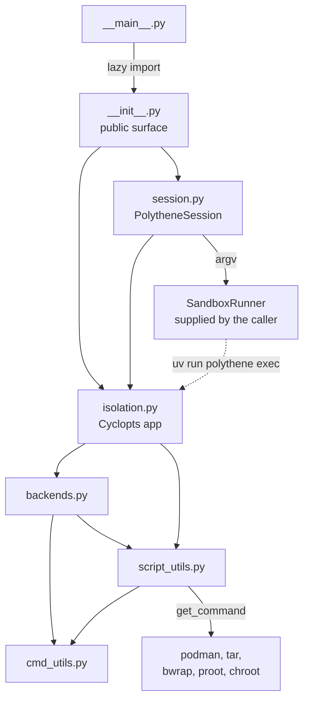

# Developer guide

This guide records the architecture, package layout, testing strategy, local
development workflow, and quality contracts for Polythene. For the command-line
interface and user-facing behaviour, see the [users' guide](./users-guide.md);
for the trade-offs behind the current design, see the
[design document](./polythene-design.md).

## Architecture overview

Polythene is a small package arranged in three cooperating layers:

- `isolation.py` owns the Cyclopts application, the `pull` and `exec` commands,
  the store layout, and the registry *binding* — it holds
  `BACKENDS = create_backends()`, while `backends.py` constructs the tuple.
- `backends.py` describes the execution backends — bubblewrap, proot, and
  chroot — as data, together with the probes that decide whether each one can
  run.
- `cmd_utils.py` and `script_utils.py` hold the process and filesystem helpers
  the other two layers share. `cmd_utils.py` owns `POLYTHENE_CATALOGUE` — the
  curated list of every executable the package may start — together with
  `program`, which turns a curated name into a cuprum builder, and `run_cmd`,
  which echoes and then runs a command. `script_utils.py` adds `get_command`,
  which checks `PATH` and exits `127`, and `ensure_directory`, which creates
  the store and runtime directories.

`isolation.py` computes its configuration when the module is imported, not when
a command runs:

- `DEFAULT_STORE` is `POLYTHENE_STORE` when that variable is set, and
  `tempfile.gettempdir()/polythene` otherwise, resolved to an absolute path.
- `VERBOSE` is true when `POLYTHENE_VERBOSE` is set to any non-empty value.
  The test is `bool(os.environ.get(...))`, so an empty string leaves verbose
  mode off.
- `IS_ROOT` records whether the effective user is root (`os.geteuid() == 0`).
- `BACKENDS` is the registry returned by `create_backends()`, in the fixed
  order bubblewrap, proot, chroot.

Because those constants are bound at import time, tests patch them by attribute
(`monkeypatch.setattr(isolation, "BACKENDS", ...)`).

The environment is a second, later input. `app.config` installs
`cyclopts.config.Env("POLYTHENE_", command=False)`, which binds each
parameter's name to `POLYTHENE_<NAME>` with the name upper-cased and `-` and
`.` rendered as `_`. Binding is by parameter, not by *option*: a positional
parameter is matched too, so `POLYTHENE_UUID` supplies the `uuid` that `exec`
would otherwise take from the command line — the command then errors on its own
terms (no rootfs for that UUID) rather than for a missing argument.
`POLYTHENE_TIMEOUT` reaches `--timeout`, and `POLYTHENE_STORE` reaches
`--store`, without the option's own `env_var` being involved. A value that
cannot be coerced is reported as
`Invalid value for POLYTHENE_TIMEOUT from env`, naming the variable rather than
the option, so the message distinguishes an environment fault from a bad
command line. `--store` and `--isolation` also declare `env_var` explicitly,
which makes the binding legible at the option rather than only in the app's
configuration.

Both routes are read afresh on each invocation, so a variable set after import
still reaches the command even though `DEFAULT_STORE` was fixed at import. The
two agree for `POLYTHENE_STORE`; the `default` of `--store` is the
already-resolved `DEFAULT_STORE`, so an unset variable leaves the import-time
value in place.

A command token that *looks like one of the command's own options* survives
only because a bare `--` separates it from the outer parser: after the
delimiter, Cyclopts stops parsing options and passes the remainder through as
tokens, so `exec UUID -- --timeout notanint echo x` reaches the rootfs while
`exec UUID --timeout notanint echo x` fails on the coercion of `notanint`. That
is the form `PolytheneSession` emits. The `--` is load bearing; the
`app.end_of_options_delimiter = "--"` assignment beside the app is not. The
field's own default is `None`, and the parser resolves it with
`AppStack.resolve("end_of_options_delimiter", fallback="--")`, so an unset
attribute and an explicitly assigned `"--"` behave the same. The assignment
records the default rather than enabling it; removing it would not change
behaviour. `CommandToken`'s `allow_leading_hyphen` covers the rest, admitting a
hyphen-led token such as `-n` in either form.

Three terms recur throughout this guide, and are kept distinct:

- **Backend availability fallback** — `exec` probing backends in order and
  moving to the next when one declines. It decides which tool runs a command,
  not what that command does.
- **Process execution** — running the inner command through the selected
  backend, and turning the resulting status into the CLI's exit code.
- **Persistent rootfs storage** — the store directory of UUID-named root
  filesystem trees that outlives any single invocation, so a `pull` in one job
  can be reused by a later `exec`.

For screen readers: the diagram shows how the package modules depend on one
another, how the helper layer resolves the external tools, and how
`PolytheneSession` reaches the CLI through a caller-supplied runner.



## Package layout

The `polythene/` package holds seven modules:

| Module            | Role                                                  | Key APIs                                                                                                                                                                                         |
| ----------------- | ----------------------------------------------------- | ------------------------------------------------------------------------------------------------------------------------------------------------------------------------------------------------ |
| `__init__.py`     | Public package surface                                | `DEFAULT_STORE`, `CONTAINER_TMP`, `BACKENDS`, `IS_ROOT`, `VERBOSE`, `app`, `cmd_pull`, `cmd_exec`, `export_rootfs`, `generate_uuid`, `log`, `main`, `store_path_for`, `PolytheneSession`         |
| `__main__.py`     | Module entry point                                    | `main`                                                                                                                                                                                           |
| `isolation.py`    | CLI, configuration, store layout, image export        | `app`, `cmd_pull`, `cmd_exec`, `export_rootfs`, `generate_uuid`, `store_path_for`, `log`, `DEFAULT_STORE`, `CONTAINER_TMP`, `VERBOSE`, `IS_ROOT`, `BACKENDS`, `IsolationName`, `ISOLATION_NAMES` |
| `backends.py`     | Backend descriptors and availability probes           | `Backend`, `BackendContext`, `BubblewrapUnavailable`, `create_backends`, `ensure_runtime_paths`, `make_prepare_bwrap`, `make_prepare_proot`, `make_prepare_chroot`                               |
| `cmd_utils.py`    | Process execution and echoing                         | `POLYTHENE_CATALOGUE`, `program`, `run_cmd`, `fail_on_error`, `failure_detail`, `command_result`                                                                                                 |
| `script_utils.py` | Command resolution and filesystem helpers             | `get_command`, `ensure_exists`, `ensure_directory`, `unique_match`, `PKG_DIR`                                                                                                                    |
| `session.py`      | Argument-vector construction for programmatic callers | `PolytheneSession`, `SandboxRunner`                                                                                                                                                              |

The `polythene/unittests/` directory is a legacy placeholder holding only a
`README.md`; the suite lives in `tests/`, described under
[Testing strategy](#testing-strategy).

`__main__.py` imports lazily: its `main` performs
`from . import main as package_main` inside the function body, so
`python -m polythene` reaches the package's `main` without importing the CLI at
module scope. Both subcommands are defined in `isolation.py` with the Cyclopts
decorators (`@app.command(name="pull")` and `@app.command(name="exec")`), and
the package-level `main(argv)` passes `sys.argv[1:]` to the app. The
`polythene` console script declared in `pyproject.toml` points at
`polythene.__main__:main`, so the installed entry point and
`python -m polythene` converge on the same function.

Exit codes are few and deliberate:

| Code  | Raised by                       | Condition                                             |
| ----- | ------------------------------- | ----------------------------------------------------- |
| `1`   | `cmd_exec`                      | The UUID has no directory in the store                |
| `1`   | Cyclopts option validation      | `--isolation` names an unknown backend                |
| `2`   | `cmd_exec`                      | No command tokens were supplied                       |
| `2`   | `ensure_exists`, `unique_match` | A required path is missing, or a match is not unique  |
| `126` | `cmd_exec`                      | Every isolation backend declined                      |
| `127` | `get_command`                   | A required binary, such as `podman`, is not on `PATH` |

Other statuses are propagated rather than translated in the places that handle
them: a backend's non-zero status from `cmd_exec`, and an unexpected probe
status, each become the CLI's exit code, as do the statuses of `podman pull` and
`podman create`. Cuprum returns a non-zero exit as data rather than raising, so
`fail_on_error` performs that translation once and every caller uses it: a
signal-derived negative status is passed through unchanged, so it still exits
non-zero, and anything without a usable code — `0` or `None` where a failure
was expected — becomes `1`.

The export pipeline is not an exception. `podman export CID | tar -C DEST -x`
runs inside a `try/finally` that only removes the container, and its result is
handed to `fail_on_error` like every other command's, so a failed export exits
with the *failing stage's* status and prints `Failed to export rootfs of CID`.
Cuprum kills the final stage once its input dies, so the final stage's status
is signal-derived and says nothing about what went wrong; `fail_on_error`
therefore reports the first failing stage rather than the last one.

`PolytheneSession` builds an argument vector and hands it to its runner. It
does not execute anything itself, does not create or clean the store, and does
not check that the UUID exists — all of that stays with the CLI.

## Runtime flows

### `polythene pull`

1. `cmd_pull` ensures the store directory exists.
2. It generates a UUIDv7 with `uuid7()` and takes `store/UUID` as the
   destination.
3. `export_rootfs` resolves `podman` and `tar` through `get_command`, which
   exits `127` when either is missing.
4. It probes local storage with `podman image exists IMAGE`, captured rather
   than inherited so the status is read rather than acted on: `0` means the
   image is present, `1` means it is absent, and anything else — `125` for
   unreadable storage included — prints `Failed to check for local image IMAGE`
   and exits with that status.
5. When the probe reports the image absent, it pulls with `podman pull IMAGE`
   in the foreground; a non-zero status prints `Failed to pull image IMAGE` and
   exits with the failing command's status.
6. It creates the destination directory with `exist_ok=False`.
7. It creates a stopped container with `podman create --pull=never IMAGE true`,
   reads the container ID from that command's stdout, streams
   `podman export CID | tar -C DEST -x`, and removes the container with
   `podman rm CID` in a `finally` block whose failure is suppressed.
8. It writes `DEST/.polythene-meta` best-effort, `cmd_pull` calls
   `ensure_runtime_paths` to create `dev/` and `tmp/`, and the UUID is printed
   to stdout.

Printing the UUID alone is a contract, so steps 5 and 7 sink `podman pull` and
`podman rm` to `os.devnull`: those two report the image and container ID on
stdout and would otherwise contaminate it. The `podman create` in step 7 also
writes a container ID to stdout, but there that output is the *intended* result
rather than noise — it is read back and stripped into `cid`, which is why that
call stays on the ordinary path.

Cleanup is deliberately looser than the export it follows. The `podman rm` in
the `finally` block runs through the same `run_cmd`, so a non-zero status is
data rather than an exception: it is returned, and the block simply ignores it,
because the export's outcome is the one the caller needs to see. A cleanup that
times out raises `cuprum.TimeoutExpired` (a `TimeoutError`) instead, which does
escape the `finally` block; the container can be left behind either way. The
image is pulled at most once per `pull`, and the persistent artefacts are the
exported directory and its metadata file. `--timeout` reaches every external
command in the flow, so it bounds each operation rather than the export as a
whole. A collision on the destination directory raises `FileExistsError`, which
`cmd_pull` answers by generating a fresh UUID once and retrying.

### `polythene exec`

1. `cmd_exec` requires at least one command token; otherwise it prints
   `No command provided` and exits `2`.
2. It resolves the rootfs path; when it is not a directory it prints
   `No such UUID rootfs: UUID (PATH)` and exits `1`.
3. It normalizes the tokens — a single sequence argument is flattened, and any
   non-string token raises `TypeError` — and quotes them with `shlex.quote`
   into one inner command string.
4. It walks the backend order, running each candidate. Python's `None` means
   the backend declined: the CLI logs the fallback and tries the next one. A
   `(name, status)` pair with status `0` returns, and any other status exits
   with that code.
5. If no backend ran, it prints
   `All isolation modes unavailable (bwrap/proot/chroot).` and exits `126`.

The order walked in step 4 is the registry order — bubblewrap, proot, chroot —
unless `--isolation` reorders it. The accepted names are `bubblewrap`, `proot`,
and `chroot`; anything else is rejected by the option's annotation — Cyclopts
prints `Invalid value for "--isolation"` and exits `1` — so the
`except KeyError` branch inside `cmd_exec` is unreachable from the CLI. A
requested backend is tried first and the remainder follow in registry order, so
the preference is a reordering rather than an exclusive selection. `chroot` is
the only backend that sets `requires_root`, and it is skipped when the
effective user is not root; bubblewrap and proot are never skipped for
privilege reasons.

### Backend probes and flags

Each backend resolves its binary before running any probe: a `SystemExit` from
`get_command` is logged and the backend declines with `None` without probing at
all. Probes otherwise run before the real command and decline by returning
`None` rather than raising, which is what drives the availability fallback.

- **bubblewrap** (`bwrap`). `_probe_bwrap_userns` short-circuits without
  running anything when the process is not root and
  `/proc/sys/kernel/unprivileged_userns_clone` reads exactly `0`; a missing
  file is not fatal, and an unreadable one is logged and ignored. It then runs
  `bwrap --unshare-user --uid 0 --gid 0 --bind / / true`. A *recognized*
  permission error — `Permission denied` in the output, or `errno.EPERM` —
  disables bubblewrap outright; an unrecognized failure logs and continues with
  an empty flag list. A successful probe contributes
  `--unshare-user --uid 0 --gid 0`, extended with
  `--unshare-pid --unshare-ipc --unshare-uts`. `_probe_bwrap_proc` binds the
  root and tries `--proc /proc`, keeping that flag only if it works. The full
  probe binds the root at `/`, dev-binds `/dev`, adds the proc binding when it
  survived, mounts a tmpfs over `CONTAINER_TMP`, changes to `/`, and runs
  `/bin/sh -c true`; execution reuses the same flags with the inner command in
  place of `true`.
- **proot** (`proot`). The probe runs `proot -R ROOT -0 /bin/sh -c true` and
  execution runs `proot -R ROOT -0 /bin/sh -c INNER`. The shell is deliberately
  not a login shell, so profile scripts cannot change the environment between
  the probe and the real command.
- **chroot** (`chroot`). It sets `requires_root` and clears `ensure_dirs`, so
  it neither runs as an unprivileged user nor recreates the runtime
  directories. The probe runs `chroot ROOT /bin/sh -c true`; execution runs
  `chroot ROOT /bin/sh -lc 'export PATH=/bin:/sbin:/usr/bin:/usr/sbin; INNER'`.
  This is the only login shell in the package, and the fixed `PATH` is there
  because chroot supplies no environment of its own.

These flags concern namespaces and mounts rather than isolation boundaries that
Polythene enforces. Bubblewrap unshares the user, PID, IPC, and UTS namespaces;
no backend is given a network-namespace flag, and this guide makes no claim
that any of the three blocks network access.

### Process execution

Cuprum is the only way Polythene starts a process. `cmd_utils.py` owns the
shared catalogue and execution entry point; other production modules consume
its helpers and name cuprum's types, `backends.py` importing `CommandResult` and
`SafeCmdBuilder` directly and `script_utils.py` and `isolation.py` naming
`SafeCmdBuilder` in annotations. The test support under
[Testing strategy](#testing-strategy) builds cuprum values as well, so that the
suite starts children the same way. Two decisions live in `cmd_utils.py`.

**The catalogue decides what may run.** `POLYTHENE_CATALOGUE` curates exactly
the executables the package starts: `podman`, `tar`, `bwrap`, `proot`, and
`chroot`. `program(name)` asks cuprum for a builder for one of those names, and
cuprum refuses a name the catalogue does not list *when the command is built*,
so a typo in a backend's binary fails before any probe spawns. The check is on
the name, not on `PATH`: `get_command` performs the `shutil.which` check
separately, because cuprum resolves an executable only when the command runs
and the CLI's documented missing-binary behaviour is the `127` exit with its
one-line diagnostic.

**`run_cmd` is the single place that starts a command.** It echoes
`$ <command>` to stderr, runs the command through cuprum's `run_sync`, and
returns the result. It accepts a cuprum `SafeCmd` or `Pipeline` and rejects
anything else with a `TypeError` naming the correct form. Cuprum reports a
non-zero exit as data rather than raising, so nothing here translates a failure
into an exception; `fail_on_error` does that once, at the point where a caller
needs a process status.

The echo line is the reason the two entry points differ at all. `program()`
rejects an uncurated name at build time; `get_command` checks `PATH` and exits
`127` before building. Both return a builder, and every caller invokes it with
the command's arguments — including when there are none, because the builder is
not the command.

#### Streams

Cuprum does **not** inherit the parent's streams by default, which is the one
behaviour that most easily surprises a caller arriving from `subprocess` or
`plumbum`. With `capture` and `echo` both off, an unset target resolves to a
library pipe whose far end nothing reads, so the child's output is discarded
rather than passed through. Foreground execution therefore has to name
`StdioTarget.inherit()` explicitly:

- `fg=True` builds
  `RunOutputOptions(capture=False, echo=False, stdout=…, stderr=…)` with
  `StdioTarget.inherit()` for each stream the caller left unset. A path or
  `StdioTarget` override replaces that stream.
- `fg=False` builds `RunOutputOptions(capture=True, echo=False)` and returns
  both streams on the result. Overrides are refused with a `ValueError`,
  because a captured stream is a parent-side pipe that a redirected stream does
  not have; cuprum rejects the combination too, and refusing it here names the
  caller's own mistake.
- A pipeline binds its intermediate streams across stages, so cuprum refuses a
  `RunOutputOptions` stdio target for one outright. `run_cmd` therefore rejects
  `stdout`/`stderr` for a pipeline with its own `ValueError`, and a foreground
  pipeline can reach the caller only by echoing (`echo=True`).

Stream overrides exist for callers that must keep a chatty tool off their own
streams. `polythene pull` passes `stdout=os.devnull` for `podman pull` and
`podman rm`, so the UUID stays the only line it prints. When a call is not
foreground, `run_cmd` returns the child's output to the caller instead of
inheriting the terminal streams: the `podman image exists` probe and
`podman create` are both non-foreground, and their callers read the result.
Every foreground call inherits the streams it did not explicitly redirect, and
the child keeps the caller's stdin, so a foreground command that reads stdin
sees the terminal rather than an immediate EOF.

#### Failures and timeouts

`failure_detail` renders a one-line diagnostic from a result: the captured
stderr when the tool wrote one, otherwise just the exit status. The status
itself comes from `fail_on_error`, which passes a signal-derived negative value
through unchanged — it is already non-zero, which is all the shell needs — and
treats a missing code as `1`.

A pipeline needs one extra rule. Cuprum kills a stage once its input dies, so a
pipeline that failed early has two candidate statuses: the failing stage
reports what went wrong — `tar` exits `1` on a truncated archive — while the
final stage reports a signal-derived status because it was killed.
`fail_on_error` returns the *failing* stage's status, and `failure_detail`
names that stage and index.

Timeouts raise `cuprum.TimeoutExpired`, which derives from `TimeoutError`. That
is true for every call, foreground or captured, because cuprum raises it from
`run_sync` rather than from a stream-specific path; there is no second
exception type to catch.

The `timeout` value travels with each operation rather than the invocation: in
`pull` it reaches the probe, the pull, `create`, the export, and `rm`, and in
`exec` it reaches every probe and the final execution. It is therefore a budget
per external command, not for the whole run.

### `PolytheneSession`

`PolytheneSession.run(uuid, command, *, isolation=None, timeout=None)` is the
programmatic entry point. It builds one argument vector:

```plaintext
uv run polythene exec UUID --store STORE [--isolation NAME] -- TOKEN...
```

The details that callers depend on:

- `command` may be a string, which is parsed with
  `shlex.split(comments=False, posix=True)`, or a sequence, which is used as
  given. Either way an empty result raises
  `ValueError("Command must contain at least one token")`.
- `--isolation` is emitted as two tokens, never as `--isolation=NAME`.
- The isolation preference order is the `isolation` argument, then
  `POLYTHENE_ISOLATION` from the session's environment, then `proot` when
  `GITHUB_ACTIONS` is truthy (`1`, `true`, `yes`, or `on`, case-insensitively).
  When none applies, no `--isolation` token is emitted and the CLI's own
  registry order decides. An unrecognized `POLYTHENE_ISOLATION` value raises
  `ValueError` naming the supported values.
- `timeout` is forwarded to `sandbox.run(argv, timeout=timeout)`. It is never
  added to the argument vector, so the CLI's `--timeout` is unaffected and the
  runner alone decides how to enforce the limit.
- `store` defaults to `DEFAULT_STORE`; a relative path is resolved against the
  working directory. `env` defaults to a copy of `os.environ` taken when the
  session is constructed.

## Testing strategy

Every test lives under `tests/`. `tests/`, `tests/bdd/`, and `tests/support/`
are real packages: their `__init__.py` files give each module one unambiguous
dotted path such as `tests.support.cli`, so a helper can be imported by name
from anywhere in the suite. There is no `tests/unit/` directory.

`tests/workflow_contracts/` is the exception. It has no `__init__.py`, so
pytest imports each module by the bare filename — `test_cv005_wiring`, not
`tests.workflow_contracts.test_cv005_wiring` — and puts the directory on
`sys.path` to do it. Nothing in those modules imports a sibling, so the two
conventions do not collide; a helper added there would need the package
treatment the rest of the suite uses and would belong in `tests/helpers/`
instead. The cuprum pin readers already live there, in
`tests/helpers/cuprum_pin.py`, precisely because two modules assert on them.

| Location                                        | Contents                                                                                                                                                            |
| ----------------------------------------------- | ------------------------------------------------------------------------------------------------------------------------------------------------------------------- |
| `tests/test_*.py`                               | Unit tests for the package modules: the CLI, the backend probes, the image-export contract, the process helpers, the script-utility helpers, and the session helper |
| `tests/features/*.feature`                      | Gherkin scenarios describing CLI, command-execution, and script-utility behaviour                                                                                   |
| `tests/bdd/test_*_behaviour.py`                 | pytest-bdd step bindings that execute those scenarios                                                                                                               |
| `tests/conftest.py`                             | The `run_cli` and `run_module_cli` fixtures                                                                                                                         |
| `tests/support/`                                | Importable helpers: the `CliResult` type and the recording Podman doubles                                                                                           |
| `tests/test_workflow_contract.py`               | Contract tests for the mutation-testing caller workflow                                                                                                             |
| `tests/workflow_contracts/test_cv005_wiring.py` | Contract tests for the CV-005 checker's local wiring                                                                                                                |
| `tests/workflow_contracts/test_cuprum_pin.py`   | Contract tests holding the cuprum pin, the lock, and the installed version together                                                                                 |

Test bodies call real functions. Where a module starts a process, the double
replaces the resolution point rather than the logic: `tests/support/podman.py`
provides typed recording stand-ins for `podman` and `tar`, and
`install_recording_tools(monkeypatch)` patches
`polythene.isolation.get_command` and `polythene.isolation.run_cmd` so
`export_rootfs` runs end to end with the real control flow and no container
runtime. The doubles return *real* cuprum results — a `CommandResult`, or a
`PipelineResult` built from one result per stage — rather than a lookalike, so
the code under test exercises the same accessors production uses. The recorded
`CommandRecord` objects carry the argv, the `fg` choice, the timeout, and the
other run options, so a test can assert ordering and exact arguments. Other
tests run genuinely lightweight commands — `echo`, `sh`, and a one-line Python
snippet — through cuprum, which is what the `run_cmd` tests are about.

Anything that must cross a real process boundary goes through
`tests/support/process.py`, which builds a one-program catalogue per call. That
covers the CLI entry points, the release workflow's Bash steps, `make -n` in
the workflow contracts, and the fresh-interpreter environment test. Keeping one
helper for all of them means the suite has a single way to start a process
rather than one per test module.

Each Gherkin feature file lives in `tests/features/` and is bound by a module in
`tests/bdd/` through `scenarios("../features/NAME.feature")`; the bindings are
decorated with pytest-bdd's `given`, `when`, and `then`, with `parsers.parse`
supplying the step parameters. Adding a scenario therefore means adding a
`.feature` line and any steps it needs, not a new test function.

`tests/conftest.py` exports two fixtures. `run_cli` calls `polythene.app(args)`
with stdout and stderr redirected and turns the resulting `SystemExit` into an
exit code. `run_module_cli` runs `run_module("polythene", run_name="__main__")`
with `sys.argv` patched, so the module entry point is covered as well; it
restores the patch in a `finally` block. Both return a
`tests.support.cli.CliResult` holding `exit_code`, `stdout`, and `stderr`.
Those helpers live in `tests/support/` rather than in `conftest.py` so every
consumer imports the same module object; pytest collects `conftest.py`
specially, and `from conftest import ...` can otherwise create a second,
structurally identical copy of a type under some import-mode combinations — the
problem mutmut's sandbox exposed.

The suite uses no mocking framework: there is no `cmd-mox` and no
`pytest-mock`, and neither is a declared dependency. Doubles are handwritten
classes, a local stub, or `monkeypatch`. `pytest-timeout` is a development
dependency, and `[tool.pytest.ini_options]` sets `timeout = 30`, so every test
is killed after thirty seconds.

### CLI contract tests

`tests/test_cli_contract.py` pins the command-line *contract* rather than any
one implementation of it. `CliResult` compares exit status and both output
streams across three entry points — the in-process app, `python -m polythene`,
and the installed console script. `assert_cli_diagnostic` checks a non-zero
status, normalized diagnostic fragments, and an empty other stream, and
`assert_no_process_launch` checks that a rejected command never printed the
`$ cmd` launch echo. The in-process invalid-isolation case additionally checks
that the recording backends received no calls. The helpers deliberately ignore
Rich borders and whitespace: they assert useful diagnostic content, not Rich
layout or Cyclopts' exact wording. That is what makes a dependency bump
testable — the wording may move, the contract may not.

Comparing a Cyclopts update uses one fixed base containing the contract tests.
Install its locked dependencies in the control environment:

```shell
UV_PYTHON=3.13 UV_PROJECT_ENVIRONMENT=.venv-cyclopts3 uv sync --locked --group dev
```

In a separate worktree, apply only the dependency and lock changes, then
install the treatment environment:

```shell
UV_PYTHON=3.13 UV_PROJECT_ENVIRONMENT=.venv-cyclopts4 uv sync --locked
```

Record each environment's Python patch, Cyclopts, and Rich versions. Run the
unchanged regression test first; if it fails in the control, stop and record
that as a baseline issue. Then run `tests/test_cli_contract.py` with
`POLYTHENE_TEST_DIAGNOSTIC_STREAM=stdout` and again with it set to `stderr` in
both environments, followed by `uv run --locked pytest -v`. Classify every
failure against the control and retain the stream, status, and backend-call
evidence in the change description rather than committing a test artefact.
Repeat the matching `UV_PROJECT_ENVIRONMENT` setting on every `uv run` command;
the setting used by `uv sync` applies only to that command. For example, run
the treatment checks with:

```shell
UV_PROJECT_ENVIRONMENT=.venv-cyclopts4 uv run --locked pytest -v
```

Use `.venv-cyclopts3` for control checks.

## Mutation and contract testing

Mutation testing does not run locally. There is no mutation Make target, and
`mutmut` is not a declared dependency; the configuration in `pyproject.toml`
(`source_paths = ["polythene/"]`,
`pytest_add_cli_args_test_selection = ["tests/"]`) exists for the workflow that
runs elsewhere.

`.github/workflows/mutation-testing.yml` is a thin caller: it schedules the
shared `leynos/shared-actions/.github/workflows/mutation-mutmut.yml` reusable
workflow daily at 05:50 UTC, offers a plain `workflow_dispatch`, and pins the
reusable workflow to a full commit SHA. The `with:` block passes only
`paths: "polythene/"` and `module-prefix-strip: ""`. Thresholds, reporting, and
tool versions belong to the shared workflow, not to this repository, and the
caller narrows its token to `contents: read` plus `id-token: write` for the
workflow-source resolution. `tests/test_workflow_contract.py` parses that
caller and asserts its shape: the workflow path, a 40-character commit SHA, the
least-privilege permissions, the empty top-level `permissions`, the
non-cancelling per-ref concurrency group, the schedule and dispatch triggers,
and the two `with` values. It deliberately does not assert the SHA value, which
Dependabot owns. Run these checks locally with:

```shell
uv run pytest tests/test_workflow_contract.py -v
```

`tests/test_workflow_contract.py` carries a `pytest.mark.skipif` on the
workflow path, because mutmut's `mutants/` sandbox does not copy `.github/`;
the reason string in the skip marker says so. Without that guard the sandboxed
run would fail on a missing file rather than on a real defect. That guard is
local to this module, not a convention the suite follows:
`tests/workflow_contracts/test_cv005_wiring.py` has no `skipif`, so a missing
`Makefile` or `ci.yml` makes it fail rather than skip.

The CodeScene contract works the same way but runs locally.
`make test-workflow-contracts` runs `cv005-contracts check --repository .` from
the shared `cv005-contracts` library in `leynos/shared-actions`, pinned by
`CV005_CONTRACTS_REF`, and protects the separation between pull-request
ratcheting and main-branch CodeScene publication. The rules it enforces, and
the reasoning behind them, are in [Coverage ownership](#coverage-ownership).
What the library cannot prove is that this repository calls it, so
`tests/workflow_contracts/test_cv005_wiring.py` reads the Makefile with
`make -n` and parses the workflow to hold the pin to a full commit, the target
to `check --repository .` under Python 3.13, `.github/cv005.toml` to this
repository's name, `make all` to the target, and CI to an unconditional step
that runs it. The decision to take the library rather than keep a local copy is
recorded in [ADR 001](adr-001-adopt-the-shared-cv005-contract-library.md).

Both layers check configuration, not outcomes. The contracts prove the pin, the
wiring, and the workflow shape; they do not run the CodeScene upload, so a
green contract target says nothing about whether an upload will succeed. The
publisher run on the merge commit remains the proof of that.

## Local development workflow and Makefile gates

`make build` creates `.venv` and installs the runtime and development
dependencies: the `.venv` rule runs `uv venv --clear` and the `build` rule runs
`uv sync --group dev`, both with `UV_CACHE_DIR=.uv-cache` so the cache stays
inside the working copy.

| Target                    | Effect                                                                                                            |
| ------------------------- | ----------------------------------------------------------------------------------------------------------------- |
| `all`                     | The default goal: `build`, `check-fmt`, `test`, `typecheck`, `spelling`, `test-workflow-contracts`                |
| `build`                   | Create `.venv` and install the development dependencies                                                           |
| `test`                    | `build`, `uv`, `pytest`, and `test-workflow-contracts` prerequisites, then `uv run pytest -v`                     |
| `test-workflow-contracts` | Run the pinned `cv005-contracts check --repository .`                                                             |
| `lint`                    | `ruff check polythene tests`                                                                                      |
| `fmt`                     | Apply fixes: `ruff format`, `ruff check --select I --fix`, `mdtablefix --in-place`, and `markdownlint-cli2 --fix` |
| `check-fmt`               | Verify only, without writing: `ruff format --check` and `mdtablefix --check`                                      |
| `typecheck`               | `build`, then `ty check polythene tests`                                                                          |
| `markdownlint`            | `spelling`, then `markdownlint-cli2 "**/*.md"`                                                                    |
| `spelling`                | The pinned `typos-config-builder gate`                                                                            |
| `nixie`                   | Validate the Mermaid diagrams                                                                                     |
| `build-release`           | `build`, then `python -m build --sdist --wheel`                                                                   |
| `clean`                   | Remove build artefacts, caches, coverage output, and `.venv`                                                      |
| `help`                    | List the documented targets                                                                                       |

Four targets take a tool-check prerequisite as well as the one shown: `lint`,
`fmt`, and `check-fmt` each depend on `ruff`, and `typecheck` depends on `ty`.
`markdownlint` names `$(MDLINT)`, and `nixie` names `$(NIXIE)`, under the
conditional membership described above.

`make all` is not the whole gate set. It runs `build`, `check-fmt`, `test`,
`typecheck`, `spelling`, and `test-workflow-contracts`; `lint`, `markdownlint`,
and `nixie` are not in it and must be run separately. The full sequence for a
change to this repository is therefore:

```shell
make fmt
make check-fmt
make lint
make test
make typecheck
make markdownlint
make nixie
```

`fmt` writes and `check-fmt` only reports, so running `fmt` before `check-fmt`
is what keeps the second command quiet. `check-fmt` also runs `mdtablefix` with
`--git --include-untracked`, selecting the Markdown files Git tracks plus the
untracked files it does not ignore, which is why a new document is formatted
before it is ever staged.

`typecheck` runs `ty`. Pyright is configured for this repository —
`[tool.pyright]` sets `typeCheckingMode = "strict"` over `polythene` and
`tests` — but no Make target and no CI step invokes it, so it is an editor-time
setting rather than an enforced gate.

The tool-check targets verify prerequisites and never install them. `pytest` is
checked inside the virtual environment with `uv run which`, and a missing tool
normally fails the target with a message naming it. The check is driven by
`TOOLS`, and membership of that list is itself conditional: `NIXIE` is defined
as `$(shell which nixie)`, so on a machine without `nixie` the variable expands
to the empty string and silently drops *out* of `TOOLS`. The `nixie` target
still declares `$(NIXIE)` as a prerequisite, but with nothing left to expand to
there is no guard to run, and the target fails on the shell's
`command not found` instead of on the tool-check's message. `MDLINT` does not
have this failure mode because it falls back to a fixed `$HOME/.bun/bin/...`
path rather than to the empty string. Beyond the tool-check:

- `fmt` and `check-fmt` call `mdtablefix` directly and need version 0.6.0 or
  later, the first release with both `--check` and `--git`; CI installs 0.6.1
  and pins it at the install step.
- `nixie` validates Mermaid blocks. CI installs `nixie-cli` and `merman-cli`
  explicitly.
- `spelling` runs `typos-config-builder` through `uv tool run --python 3.14`
  at the pinned version `v0.1.3`, so it needs `uv` and network access to fetch
  that interpreter and the tool. It regenerates `typos.toml` and checks it, so
  a run that rewrites that file expects the regenerated version to be committed.
- `build-release` uses the plain `python` on `PATH` rather than the virtual
  environment, and `build` is not a member of the development group, so the
  target assumes `build` is importable from that interpreter. Where it is not,
  the recipe fails with `No module named build`, and `make clean` will not fix
  it: `clean` deletes `build` outputs and `.venv`, and the `build` prerequisite
  then recreates the virtual environment, but the recipe still invokes the same
  `PATH` interpreter. Install the backend for that interpreter
  (`python -m pip install build`) or supply it for one run
  (`uv run --with build python -m build --sdist --wheel`).

## Continuous integration

Five workflows run from `.github/workflows/`.

| Workflow                   | Job               | Purpose                               |
| -------------------------- | ----------------- | ------------------------------------- |
| `ci.yml`                   | `lint-test`       | The pull-request and `main` gate      |
|                            | `wheel-build`     | Assert the build makes one sdist      |
| `coverage-main.yml`        | `coverage-upload` | The `main`-only coverage publisher    |
| `mutation-testing.yml`     | `mutation`        | The scheduled mutation-testing caller |
| `dependabot-automerge.yml` | `automerge`       | Auto-merge Dependabot pull requests   |
| `release.yml`              | six release jobs  | Publish a tagged release              |

`ci.yml` runs on pushes to `main` and on every pull request, with
`contents: read`. Its steps install Python 3.13 and `uv`, run
`make test-workflow-contracts` first and unconditionally, install the diagram
and CLI tooling, validate the Makefile with `mbake`, run `make build`, install
`mdtablefix`, and then run `make check-fmt`, a Markdown lint action,
`make spelling`, `make nixie`, `make lint`, and `make typecheck`. It has no
explicit `make test` or pytest step: the tests run inside the shared
`generate-coverage` step, which is guarded to `pull_request` and passes
`python-source: ./polythene` with `with-ratchet: 'true'` and
`publish-artefact: 'false'`. The contract target runs before the tooling that
follows it, so a broken pin fails the job early rather than after the installs.

`ci.yml` also declares `wheel-build`, which runs the same `pure-python-wheel`
composite action as the release and then fails unless the build produced
exactly one sdist and one wheel. The release ships the sdist alongside the
wheel, so a pull request that produced none, or two, fails here rather than at
tag time.

`release.yml` triggers on `v*.*.*` tags and is described under
[Publishing a release](#publishing-a-release). Its six jobs are `check-version`,
`build-wheels`, `attest`, `draft-release`, `publish-pypi`, and
`publish-release`; the release uploads to PyPI through Trusted Publishing and
publishes a GitHub Release with the attested files and their Sigstore bundle.
This project has no C or Rust extensions, so the one pure Python wheel and the
sdist are the whole build.

The CodeScene publisher, the ratchet, the `codescene` environment, and the
conditions under which an upload runs are described in
[Coverage ownership](#coverage-ownership).

## Coverage ownership

Main owns CodeScene. Pull-request CI measures `polythene` serially with the
shared `generate-coverage` action, compares the result with the ratchet
baseline that `coverage-main.yml` wrote on `main` (`with-ratchet: 'true'`), and
uploads no artefact (`publish-artefact: 'false'`). It does not fetch full Git
history, invoke CodeScene, or receive `CS_ACCESS_TOKEN`. The step is guarded to
the `pull_request` event, because `generate-coverage` saves its baseline on a
push to `main` and `coverage-main.yml` must be the only workflow writing it.
Both `generate-coverage` steps set `UV_PYTHON: '3.13'`, the interpreter
`setup-python` installs. The action builds its coverage environment with
whatever interpreter uv finds first, and in the pull-request lane an earlier
step leaves a managed Python 3.14 for it to find, so without the pin the lane
and the publisher measured the same selection on different interpreters (80.82%
against 81.27%). The contract requires every generator to carry the publisher's
step `env`.

After each merge, `coverage-main.yml` regenerates the same measurement,
advances the ratchet, and uploads the Cobertura report with
`upload-codescene-coverage` in explicit `mode: upload`. A check step learns
whether the token exists with the one command
`echo "available=${{ secrets.CS_ACCESS_TOKEN != '' }}" >> "$GITHUB_OUTPUT"`,
which binds nothing, and the upload step runs only when that output is `true`
and `github.ref == 'refs/heads/main'`. The token reaches the uploader only as
its `access-token` input, because the uploader is a composite action and a step
`env` would reach every action nested in it. The ref guard means that a
`workflow_dispatch` aimed at a branch cannot publish that branch as `main`. Its
concurrency group never cancels, so no upload or baseline write is abandoned.
The group is keyed on `github.ref` alone, so runs on `main` never overlap, a
newer trigger replaces an older pending run rather than queueing behind it, and
a branch dispatch cannot displace a pending push to `main`. GitHub does not
promise to start runs in trigger order, so this is not a guarantee of commit
order: an older run can still publish last, and its coverage and baseline then
stand until a later successful run supersedes them; that is accepted. A
dispatch on `main` that replaces a pending push leaves the ratchet baseline one
commit behind until the next push, because the baseline is saved only on a
push. A manual re-run of an older run keeps its SHA and its run id: it
republishes that commit's coverage to CodeScene, but its baseline cache key
already exists, so it replaces no baseline unless the original run saved none.
Merges made by the Dependabot automerge workflow's `GITHUB_TOKEN` fire no push,
so they are published only by a manual dispatch; this is a known exception
until the shared automerge workflow dispatches the publisher itself. With no
`CS_ACCESS_TOKEN` repository secret the upload skips; the ratchet baseline is
still written.

Keep CodeScene credentials and upload actions in `coverage-main.yml`. The
retired `installer-checksum` input, the `CODESCENE_CLI_SHA256` variable, and the
`get-codescene-sha.yml` refresher are gone; the shared uploader verifies the
`cs-coverage` archive from its own manifest.

`make test-workflow-contracts` holds this shape by running
`cv005-contracts check`, the shared contract library in `leynos/shared-actions`
(`packages/cv005-contracts`), from the full commit named by
`CV005_CONTRACTS_REF` in the Makefile. The library follows local
reusable-workflow calls from every workflow a pull request can start, refuses
the CodeScene host, credential, client and uploader in that closure, and holds
the publisher, the lanes, the environment placement and the lanes' selection
parity to the rules above. A fix to a rule reaches this repository as a pin
bump. The target needs `uv`, which fetches the Python 3.13 the library runs
under. `.github/cv005.toml` holds the repository's parameters, and its
`interpreter = "3.13"` makes the library require every generate-coverage call
to pin `UV_PYTHON` to that version, inside the project's `requires-python`
(`>=3.12`), so both lanes measure on one Python. The decision is recorded in
[ADR 001](adr-001-adopt-the-shared-cv005-contract-library.md).
`tests/workflow_contracts/test_cv005_wiring.py` fails if the pin is not a full
commit, the target stops running the pinned checker, the repository parameter
is wrong, `make all` drops the target or CI stops running it.

## Publishing a release

Releases are published by `.github/workflows/release.yml`, triggered by a tag
matching `v*.*.*`. The process is modelled on cuprum's
([ADR 017](https://github.com/leynos/cuprum/blob/main/docs/adr-017-release-pipeline.md));
polythene's own record is
[ADR 002](adr-002-attested-reconciled-release-pipeline.md).

The distribution name on PyPI is `polythene-isolate`. The import package stays
`polythene`, and so does the console script, so `uv run polythene` and
`python -m polythene` are unchanged. `pyproject.toml` holds the distribution
name, and `tests/test_release_publish_steps.py` fails if the release workflow
publishes anything else.

### Cut a release

1. Set `version` in `pyproject.toml` to the release version, without the `v`,
   and refresh `uv.lock` if the change touches packaging metadata.
2. Merge that change to `main`.
3. Tag the merge commit as `v<version>` — the tag and the manifest must agree
   exactly, so `v0.2.0-beta1` matches `0.2.0-beta1` and `v0.2.0` does not.
4. Push the tag. The workflow does the rest.

A version containing a pre-release segment (`a`, `b`, `rc`, and so on) makes
`check-version` report `prerelease = true`, which marks the GitHub Release as a
pre-release. The PyPI upload is unaffected.

### What the workflow does

`check-version` compares the tag with `pyproject.toml` and reports the
pre-release status; every attest, upload, and release job waits on it.
`build-wheels` runs the `pure-python-wheel` composite action, whose plain
`uv build` produces the sdist and then the wheel built from it. `attest`
collects every wheel and exactly one sdist, refuses a build that produced
anything else, attests all of them, and hands the files and the Sigstore bundle
on as one artefact.

`publish-pypi` runs in the `pypi` environment with `contents: read` and
`id-token: write` only. It reads PyPI's Simple index, drops the names PyPI
already holds, and uploads the rest with `skip-existing: true`. `draft-release`
creates or reuses a draft GitHub Release, and `publish-release` sends it only
the assets it lacks, using PyPI's bytes for shared names, verifies both
destinations hold identical digests, then un-drafts the release. Nothing is
ever overwritten, and no step uses `--clobber`.

The index read at the start of `publish-release` can predate `publish-pypi`'s
upload, because PyPI serves it through a CDN cache; the re-read just before the
digest check therefore keeps asking, within the same six-attempt budget, until
the listing shows every name the run staged. A cache that is merely behind
delays the release instead of failing it, and the step fails only if the
listing never catches up.

The attestation bundle is named `polythene-<tag>.sigstore.json`, from the tag
alone, so a re-run finds the release already holding it. `publish-release` also
records whether the release is still a draft before it uploads and sends
nothing once it is published: a published release is complete, so a repeated
tag uploads nothing at all. Every run's attestation stays in the repository's
attestation store regardless of the asset's single name.

A bundle is attached only when it describes the bytes the release ships. Each
filename's source is chosen separately, so on a re-run whose rebuild differs
from what is already published, the release carries an earlier run's bytes for
those names — possibly alongside this run's bytes for names nothing held yet.
This run's bundle would then attest a build part of the release does not carry,
so `publish-release` withholds it and logs a notice. The attestation is not
lost — it stays in the attestation store — and the run still succeeds. A first
release, or any re-run that reproduces every published byte, attaches the
bundle as usual.

Re-running a tag's workflow is safe and is the intended recovery path for a
partly completed run: every destination converges on the same bytes per
filename, and a complete second run uploads nothing. The one case that needs a
human is a name whose bytes already differ between PyPI and the GitHub Release;
the release then stays a draft until an administrator deletes the offending
asset from the GitHub Release. PyPI's published files can never be deleted.

The release tests run under `make test`:
`tests/test_release_workflow_contract.py` holds the job scopes, environment,
concurrency, ordering, and pinned actions;
`tests/test_release_publish_steps.py`, `tests/test_release_github_steps.py`, and
`tests/test_release_reconciliation.py` execute the checked-in steps against
scratch directories and recording `gh` and `curl` stand-ins. `ci.yml` runs the
same composite action on every pull request and fails unless the build produced
exactly one sdist and one wheel, so a missing sdist is caught before a tag.

### Repository settings

Two settings outside this repository must exist before the first tag, and both
are already expected by the workflow:

- **GitHub environment `pypi`.** Create the environment under Settings →
  Environments, restrict its deployment branches and tags to tags matching
  `v*.*.*`, and add no secrets: Trusted Publishing needs only the OIDC token.
- **PyPI Trusted Publisher.** Register the `polythene-isolate` project with a
  pending publisher naming owner `leynos`, repository `polythene`, workflow
  `release.yml`, and environment `pypi`. If the project already exists, add the
  same publisher under its Publishing settings instead.

The environment name and the published distribution name are asserted in
`tests/test_release_workflow_contract.py`, so changing either in the workflow
means changing the PyPI publisher and the GitHub environment to match.

### Telemetry

polythene does not carry cuprum's `release-telemetry` action. The pipeline has
no metric consumer, and GitHub's run history and the attestation store already
record what each run did. `tests/test_release_workflow_contract.py` fails if
the action is reintroduced; the rationale is in
[ADR 002](adr-002-attested-reconciled-release-pipeline.md#no-telemetry-action).
